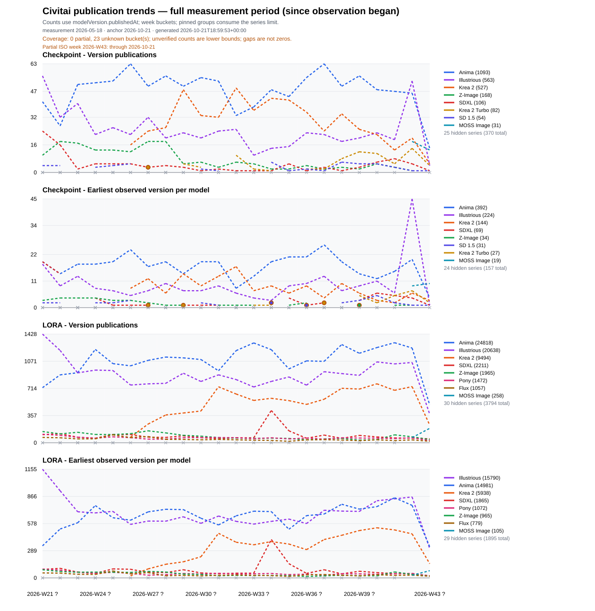
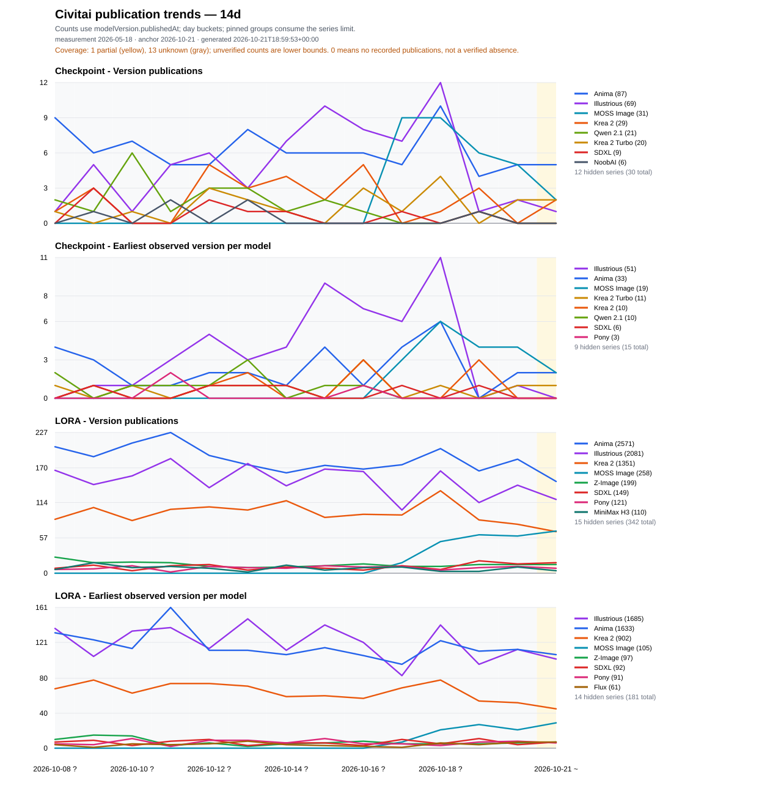

# Civitai Model Version Trends

Civitaiの公開APIで観測したモデルとバージョンを保存し、baseModel別の動向を公開します。対象はCheckpointとLoRAです。モデル本体・画像は取得しません。

## 期間を選ぶ

| 表示 | 解像度 | SVG |
| --- | --- | --- |
| 全計測期間（観測開始以降） | 週次 | [全期間](data/exports/trends-all.svg) |
| 直近90日（約3か月） | 日次 | [90日](data/exports/trends-90d.svg) |
| 直近30日（約1か月） | 日次 | [30日](data/exports/trends-30d.svg) |
| 直近14日（2週間） | 日次 | [14日](data/exports/trends-14d.svg) |





基準日は、同じDB内でCheckpointとLoRAの収集を完了したバッチの最大観測日です。今日の壁時計に合わせて空白の日付を追加しません。全期間図は計測開始以降を対象とし、Civitaiの全歴史を復元した図ではありません。既存の`trends.svg`は全期間図と同じ内容です。全期間図は従来の日次表示から週次へ変更しています。

MOSS ImageとMOSS Image Baseは同じグループへまとめます。各図はその期間内で順位を計算し、注目グループのMOSSを上位8系列の枠内で表示します。公開日不足・期間内公開なし・順位による非表示は診断CSVで区別できます。

## 指標と取得範囲

- **公開バージョン数（SVG）**: APIの`publishedAt`をJSTへ変換して集計。`publication_daily_counts.csv`と同じ値です。
- **初観測数（既存CSV）**: `first_seen_date`で集計。`daily_counts.csv`、`weekly_counts.csv`、`monthly_counts.csv`の既存の`new_version_count`・`new_model_count`の意味は維持しています。
- **モデル初公開（補助パネル）**: 観測済みversion内の最初の公開日です。観測できていないversionの存在は保証できません。

公開日がないversionを初観測日で置き換えません。取得できた件数はAPIで観測できた範囲の値です。既知ID閾値やページ上限で終了した走査は、エラーがなくても完全取得の証拠にはしません。partialは取得できた件数の下限、unknownは未確認で、確実な0件とは区別します。従来の`success`記録だけを完全取得の根拠には使いません。

`sort=Newest`の意味は、公式資料ではversion更新日時順と定義されていません。新versionの全件捕捉は保証せず、日次・週次の走査とIDの継続保存で補います。

## ローカル実行

収集・集計はPython 3.10以降の標準ライブラリで実行できます。リポジトリのルートで実行してください。

```bash
python scripts/collect_daily.py --max-pages 1 --skip-active-totals --fail-on-errors
python scripts/build_exports.py
```

小さいページ予算は動作確認用です。出力には取得範囲の制約が表示されます。既存の長期データを継続する場合は、新規DBで開始せず先にスナップショットを復元します。

```bash
python -m pip install -r requirements-sync.txt
# HF_TOKENを環境変数に設定してから実行（値をコマンド履歴に残さない）
python scripts/sync_dataset.py restore
python scripts/collect_daily.py --skip-active-totals --fail-on-errors
python scripts/build_exports.py
```

復元済みの旧DBは自動移行します。新方式による両種別の収集完了前は、一括公開用の生成を拒否します。既存のID・初観測日は維持し、移行前DBをバックアップします。

既存の単独コマンドも利用できます。

```bash
python scripts/export_counts.py
python scripts/audit_base_models.py --all --output data/exports/base_model_audit.csv
python scripts/plot_trends.py --start-date 2026-10-07 --end-date 2026-10-20 --output plots/custom.svg
python -B -m unittest discover -s tests -v
```

`plot_trends.py`は単独の日次図を生成します。通常運用では`build_exports.py`が4期間・CSV・互換SVG・manifestを一括生成します。設定は`config/base_model_groups.yaml`と`config/trend_views.json`、生成時刻を固定する検証は`--generated-at 2026-10-21T00:00:00+00:00`を使います。

## データと診断

SQLiteはローカル作業用でGit管理対象外です。長期履歴の正本は[Hugging Face Dataset](https://huggingface.co/datasets/Shiba-2-shiba/civitai-model-version-trends)の`snapshots/civitai.sqlite.gz`です。

| ファイル | 内容 |
| --- | --- |
| `data/daily_counts.csv` | 従来の日次初観測数 |
| `data/exports/daily_counts.csv` | 同じ生成バッチ内の日次初観測数 |
| `data/exports/weekly_counts.csv`, `monthly_counts.csv` | 初観測数の週次・月次集計 |
| `data/exports/publication_daily_counts.csv` | SVGの根拠となる公開日基準の集計 |
| `data/exports/base_model_audit.csv` | 未分類を含むraw値の監査 |
| `data/exports/series_diagnostics.csv` | 各期間・系列の順位、表示有無、公開日欠損等 |
| `data/exports/coverage_daily.csv` | 日付ごとの取得状態 |
| `data/exports/export_manifest.json` | 同一DB・設定・基準日・各出力のハッシュ |

`base_model_raw`とレスポンスJSONは保持し、グループは出力時に適用します。未知のraw値も集計から落としません。分類設定の重複や不正な行はエラーにします。`--fail-on-ungrouped`は全分類を明示的に管理したい場合の監査用で、通常の定期公開は未知の値だけでは停止しません。

`active_total`はAPIが提供する場合だけの補助値です。通常は取得を省略します。複数raw分類の最後の在庫値を、グループ全体の合計として表示しません。

## 定期実行と公開

GitHub Actionsは毎日14:55 UTC（23:55 JST）、週次の広い走査を日曜15:25 UTC（月曜00:25 JST）に実行します。観測日は従来どおりUTC日付に固定し、週次はその日を含む7日間を要求範囲として記録します。要求範囲自体は完全取得の証明ではありません。

収集workflowは復元→収集→一括生成→Hugging Faceの条件付き1commit→GitHubの同一生成物commitの順です。通常復元の失敗・トークン不足では公開しません。複数実行は直列化し、復元後に他の書込が入った場合は期待親revisionに対するcommitを拒否します。失敗時の診断と生成バッチはActions artifactへ保存します。

公開先の設定・初回作成・失敗後の再公開は[Hugging Face運用手順](docs/huggingface-dataset-setup.md)を参照してください。

設計と受け入れ条件: [リファクタリング計画](docs/refactoring-plan-2026-10-21.md)。変更内容・実データの診断・検証結果: [実装と検証記録](docs/refactoring-validation-2026-10-21.md)。

API仕様の根拠: [CivitaiモデルAPI](https://github.com/civitai/civitai-developer-docs/blob/main/site/reference/models.md)、[ページング](https://github.com/civitai/civitai-developer-docs/blob/main/site/guide/pagination.md)。公開の競合制御は[Hugging Face create_commit](https://huggingface.co/docs/huggingface_hub/package_reference/hf_api#huggingface_hub.HfApi.create_commit)を使います。
